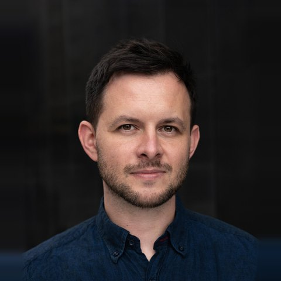

```{=html}
<div class="hero">
  
  <div>
    <div class="hero-name">Dr Paweł Motyka</div>
    <p class="role">Research assistant professor<br>Institute of Psychology, Polish Academy of Sciences<br>
    Virtual Reality and Psychophysiology Lab</p>
    <div class="profile-links">
      <a href="https://orcid.org/0000-0001-5575-5601">ORCID</a>
      <a href="https://osf.io/56x6t">OSF</a>
      <a href="https://github.com/Pawel-Motyka">GitHub</a>
      <a href="https://x.com/pawel_motyka">X</a>
      <a href="https://bsky.app/profile/pawelmotyka.bsky.social">Bluesky</a>
      <a href="mailto:pmotyka@psych.pan.pl">pmotyka@psych.pan.pl</a>
    </div>
  </div>
</div>
```

## Bio

I am a research assistant professor at the Polish Academy of Sciences, with a background in psychology and philosophy. My earlier work examined interactions between bodily and exteroceptive modalities in shaping perceptual experience. Currently, I develop a geometric framework modeling the stream of consciousness as a trajectory through experiential state space – exploring how the structure of transitions relates to the sense of self and time, whose distortions are a hallmark of altered states of consciousness. Two empirical lines develop in parallel with the framework: (i) deriving the state space bottom-up from dissimilarity ratings between altered states; (ii) investigating parametrically varied VR-simulated hallucinations – their subjective and physiological effects – as a non-pharmacological route to controlled sequences of altered experience. I have held research stays at the Max Planck Institute, Sussex Centre for Consciousness Science, and Hokkaido University, and teach consciousness science and experimental psychology at the University of Warsaw.

## Research Lines

**Framework.** I am developing a geometric model that treats the stream of consciousness as a trajectory through a multidimensional state space. The central question is how sequences of changing experiences shape the sense of self and time. These relationships remain difficult to operationalise, and their radical distortions are a hallmark of altered states of consciousness and dissociative states. I pursue the model along two empirical lines.

**Mapping the space of conscious states.** The first line reconstructs the state space from dissimilarity ratings between experiences induced by different psychoactive substances, and from first-person reports – including reports of psychiatric disorders and neurological conditions – analysed with natural language processing methods.

**VR-simulated hallucinations.** The second line uses the VR Hallucination Machine, a platform in which machine-learning algorithms distort what the participant sees and evoke hallucination-like experiences. The type and intensity of the distortions are under experimental control, which makes it possible to arrange the induced states – more or less distant from everyday experience – into planned sequences. These studies combine time-perception measures, automated analysis of free descriptions of the state, and physiological indices (eye-tracking and electrocardiography).

**Bodily influences on exteroception.** My earlier research concerned multisensory integration: the influence of body movement on visual experience, of touch and proprioception on the sense of body ownership, and of cardiac activity on somatosensory and visual perception. Across these studies I use psychophysical methods and immersive virtual reality environments.

Code and data for published studies are openly available – see [Code & data](code.qmd).

## Teaching

University of Warsaw: *Consciousness Science: Phenomena and Mechanisms* (seminar) and *Experimental Psychology* (classes).
